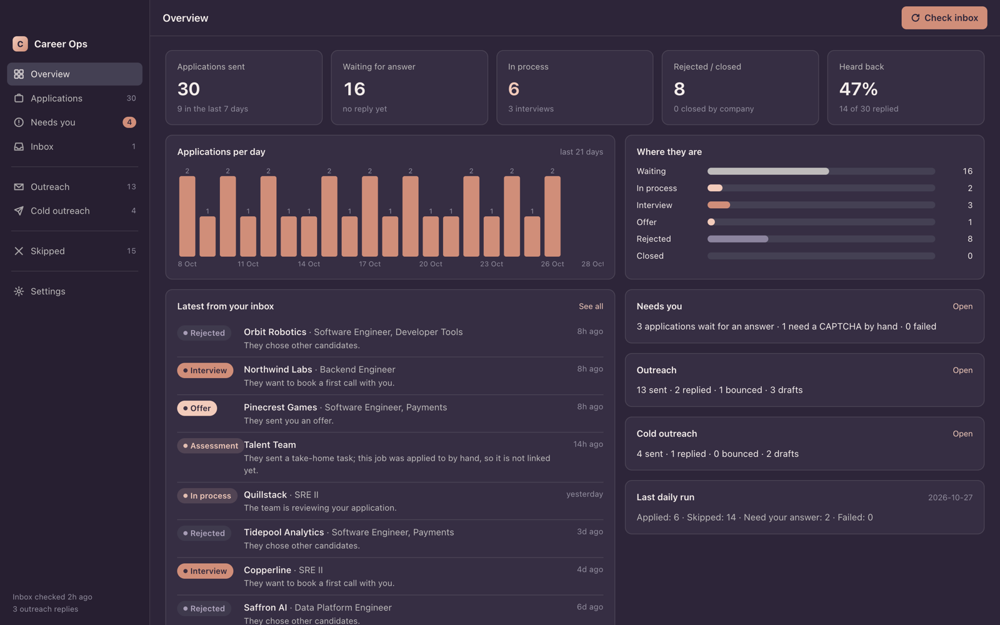
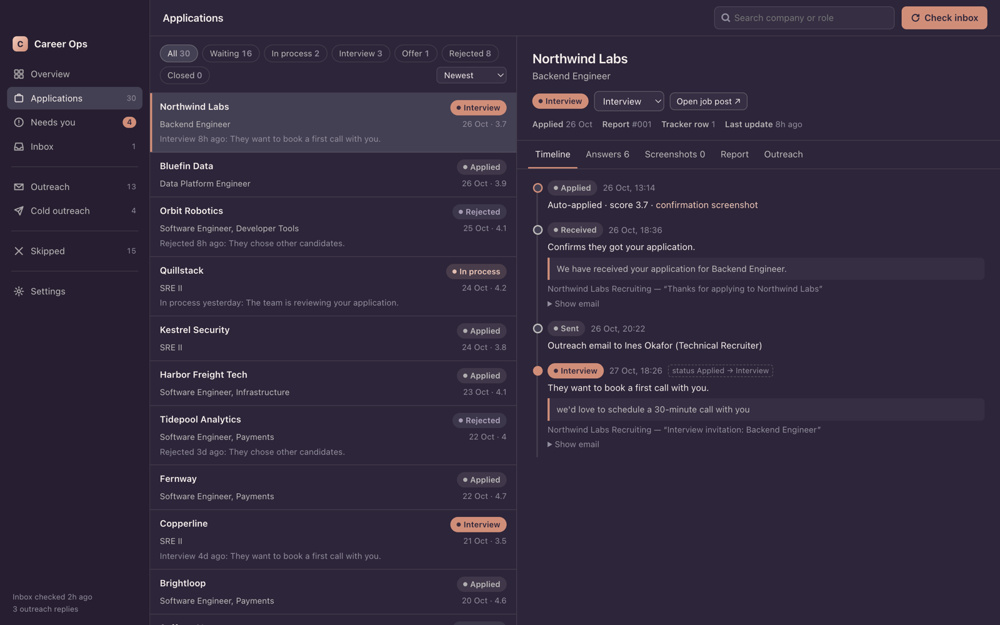
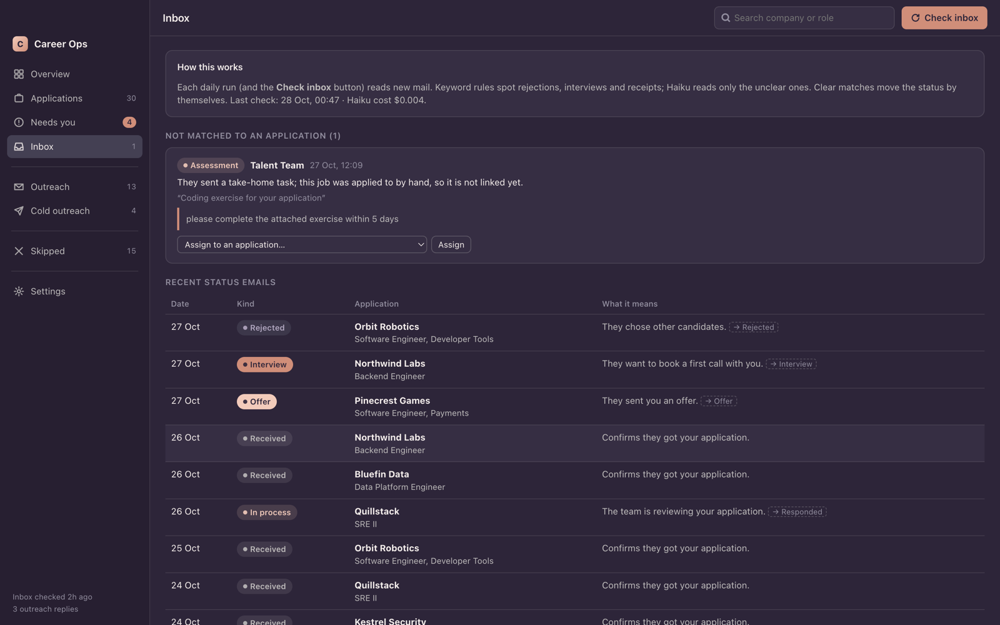
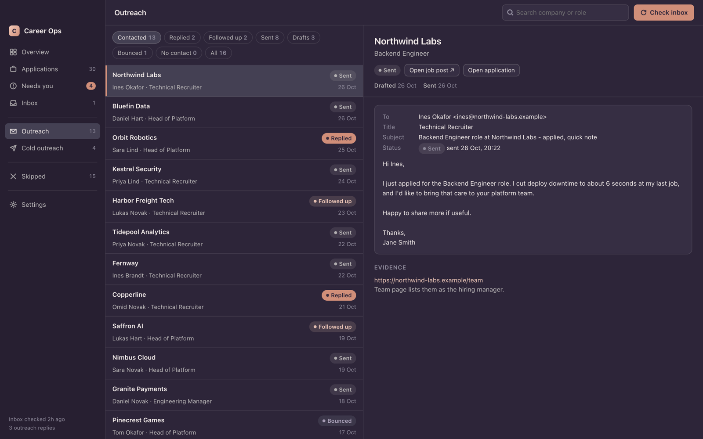

# career-ops with auto-apply and a desktop app

An unofficial fork of [career-ops](https://github.com/career-ops-hq/career-ops) (MIT).
career-ops helps you find and judge jobs with an AI CLI. This fork adds three things on top:

- **Auto-apply.** Every day it finds new jobs, checks whether each one fits you, fills the
  application form in a browser, and writes a short email to the recruiter.
- **Inbox tracking.** It reads your Gmail, finds rejections, interview invites and offers,
  and moves each application to the right status, with the reason.
- **A desktop app (macOS and Linux).** You can see every application with its status, the answers
  given, the resume sent and screenshots, plus your outreach emails. You can change all of
  your settings in the app.

> **This fork can submit applications and send emails for you.** The original career-ops
> never does. Here, nothing is submitted or sent until you turn on each permission
> yourself (in the app's setup, or in `config/apply-facts.yml`). Without them, every run
> is a practice run.

Not affiliated with or endorsed by the career-ops project.



<table>
<tr>
<td width="33%"><br><sub><b>Applications.</b> Every email and status change, the answers sent, the resume and the fit report.</sub></td>
<td width="33%"><br><sub><b>Inbox.</b> Rejections, interviews and offers found in your Gmail, matched to the right application.</sub></td>
<td width="33%"><br><sub><b>Outreach.</b> The email to each recruiter, who it went to, and whether they replied.</sub></td>
</tr>
</table>

<sub>Screenshots use made-up demo data (`node desktop/demo.mjs <empty folder>`).</sub>

---

## What you need

- macOS or Linux (Windows isn't supported yet)
- [Node.js](https://nodejs.org) 22+ and Python 3
- [Claude Code](https://claude.com/claude-code), installed and logged in. It does the work:
  it reads jobs, fills forms and writes emails, using your own Claude plan.
- A Gmail account with an [app password](https://myaccount.google.com/apppasswords)
  (for sending outreach and reading replies)
- Optional: [opencode](https://opencode.ai), for a free job-fit check. Without it, the check
  uses Claude Haiku.

## Install

```bash
git clone https://github.com/OmarAshour02/career-ops.git ~/career-ops
cd ~/career-ops
npm install
npx playwright install chromium        # the browser used to fill forms

cd desktop
npm install
npm run install-app                    # macOS: ~/Applications. Linux: your app menu
```

Then fill in your details. There are two ways.

**A. Let Claude do it (recommended).** It asks you questions and fills every file,
including answers to common form questions, so your first runs don't get stuck:

```bash
cd ~/career-ops
claude
```
```text
Set me up. Follow AI-SETUP.md. My resume is at ~/Downloads/resume.pdf
```

**B. Use the app.** Open **Career Ops** (in `~/Applications` on macOS, in the app menu on Linux).
The first-run setup asks for
your details, email account, AI tools, resume PDF and permissions. You can add the rest
later in Settings (answer bank, salary, outreach writing).

When you're ready: open the app → **Settings → Run controls** → **Practice run**, to watch
it work without submitting anything. Then turn on the daily schedule, or click **Run now**.

## Example prompts for Claude

Open `claude` in the `career-ops` folder and just ask. For example:

**Setup and settings**
```text
Set me up. Follow AI-SETUP.md.
Read my new resume at ~/Downloads/resume_v2.pdf, update cv.md and show me what changed.
Add Berlin and Amsterdam to my salary list: 65k EUR, floor 58k.
Only apply to backend and platform roles. Skip anything that needs 7+ years.
Lower my limit to 15 applications a day.
```

**Daily use**
```text
How did today's run go? Use the latest summary in autoapply/.
Answer the questions waiting in the app: my notice period is 30 days, and I'm fine with hybrid in London.
Why did the application to report #142 fail? Show me the screenshot.
Check my inbox and update the statuses.
Which applications got an interview this month?
Draft a follow-up email for the Acme application, but don't send it.
```

**Job search (from the original career-ops)**
```text
Evaluate this job for me: https://jobs.example.com/backend-engineer
/career-ops scan
/career-ops pdf
/career-ops tracker
Add these 5 companies to portals.yml: ...
```

Tips:
- **Fixing mistakes:** just say what's wrong ("this score is too high, I have Go
  experience"). Claude updates your profile files, so later runs get it right.
- **Real runs:** Claude won't start a live run unless you ask clearly. The app's
  **Run now** button is the usual way.

### Codex, Gemini, Kimi and opencode

Other AI CLIs work for the career-ops modes too. See [CODEX.md](CODEX.md),
[GEMINI.md](GEMINI.md), [KIMI.md](KIMI.md) and [OPENCODE.md](OPENCODE.md).
In Codex, slash commands are not guaranteed: ask in plain language, or run a one-shot prompt:

```bash
codex exec "Evaluate this JD with career-ops auto-pipeline: https://company.com/jobs/123"
codex exec "Run career-ops scan mode in this repo and summarize new matches."
```

The auto-apply runner itself always uses Claude Code.

## How the daily run works

`autoapply/daily.sh` runs once a day at the time you set in the app. On macOS that uses launchd.
On Linux it uses a systemd user timer, or crontab if systemd isn't running. A day missed while the
computer was off runs when it's back on (systemd and macOS).

1. **Scan** job boards (Greenhouse, Lever, Ashby and the companies in `portals.yml`).
2. **Fit check:** a cheap model reads each job and skips bad fits (too senior, wrong
   location, no visa sponsorship, wrong field).
3. **Apply:** Claude opens the form in a browser and fills it only from your files. If
   a required question has no answer, it stops and lists the question in the app.
4. **Inbox:** reads new emails and moves statuses (Applied → Rejected / Interview / Offer).
5. **Outreach:** writes a short email to the recruiter of each application, and sends it
   if you allowed that. Cold outreach is off by default.
6. **Summary:** writes `autoapply/summary-<date>.md`.

## Where things live

| What | File |
|---|---|
| Your details, answer bank, salary, limits, permissions, models | `config/apply-facts.yml` (template: `config/apply-facts.example.yml`) |
| Facts and numbers the AI may use | `cv.md` |
| Gmail login and API keys | `.env` |
| Applications and statuses | `data/applications.md` |
| One folder per application attempt: answers, screenshots | `autoapply/results/`, `autoapply/screens/` |
| Fit-check brief | `modes/_brief.md` |
| Companies to scan | `portals.yml` |

All of these are gitignored. More details: [autoapply/README.md](autoapply/README.md),
[desktop/README.md](desktop/README.md), [AI-SETUP.md](AI-SETUP.md).

## Safety and privacy

- **Nothing is invented.** Answers come only from `config/apply-facts.yml`, `config/profile.yml`
  and `cv.md`. Unknown required questions stop the application instead of guessing.
- **You give each permission yourself:** submitting, emailing about applications, and cold
  emails are separate switches.
- **Limits:** applications per day, per company in 30 days, and emails per day.
- **Pause any time:** turn off "Daily run" in the app. **Stop** ends a run that's going.
- **Your data stays on your computer.** It isn't uploaded anywhere except to the AI provider
  you use and the job sites you apply to.
- **The inbox reader only reads**, and it treats email text as data, never as instructions.

## Original career-ops features

Everything from career-ops still works: job evaluation with A–F scoring, tailored CVs as
PDF, portal scanning, batch evaluation, the interview prep and tracker modes. See the
[original README](https://github.com/career-ops-hq/career-ops#readme) and [docs/](docs/).
Setup checks: `npm run doctor`.

## License

MIT, same as the original. See [LICENSE](LICENSE). The career-ops name is covered by
[TRADEMARK.md](TRADEMARK.md). Original project by
[Santiago Fernández de Valderrama](https://github.com/santifer).
